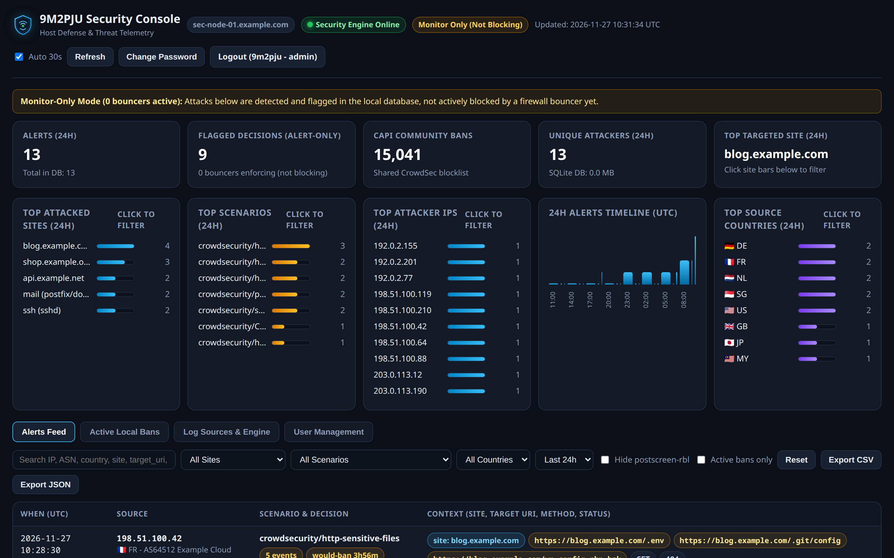
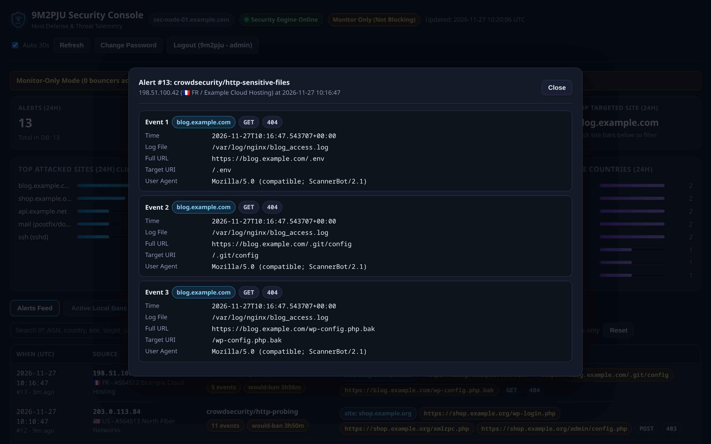
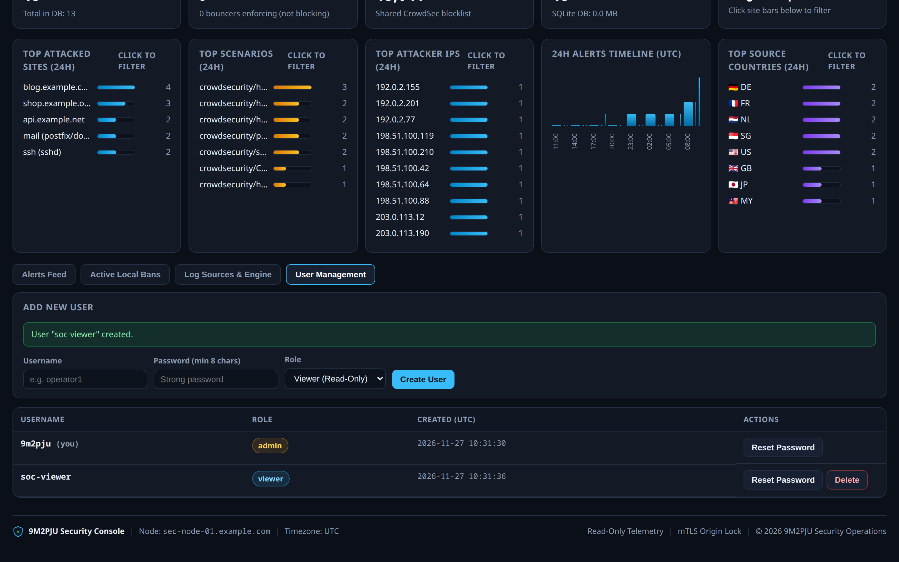
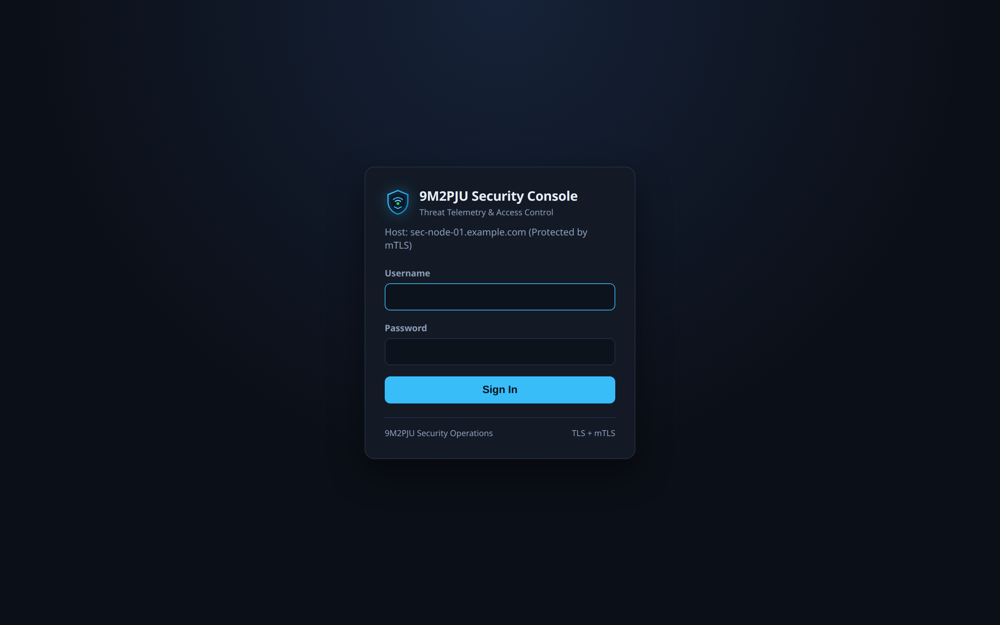

# 9M2PJU Security Console

A lightweight, single-binary web security console written in Go for monitoring CrowdSec detections, active decisions, multi-vhost targets, and acquisition health directly from your local host - with no cloud alert quota and no heavy SIEM stack.

Developed by **9M2PJU** (`https://hamradio.my`).



## Screenshots

| Alert Detail Inspection | User Management & RBAC |
| :---: | :---: |
|  |  |

<details>
<summary>Login Screen (TLS + mTLS Protected)</summary>



</details>

## Why This Exists

- **No 500-alert monthly limit:** Reads your local `crowdsec.db` (SQLite, strictly read-only) and scrapes your local CrowdSec Prometheus endpoint (`127.0.0.1:6060/metrics`) directly.
- **Minimal footprint:** Single static Go binary (`CGO_ENABLED=0`, pure-Go `modernc.org/sqlite`), ~45 MB RSS (~25 MB Docker image), zero external JavaScript/CSS CDNs, and no OpenSearch/Elasticsearch/Loki dependency.
- **Multi-vhost visibility:** Maps per-vhost log paths (via configurable `site_map` in `config.json` or CrowdSec `site` metadata) so every HTTP alert shows the full target URL (`https://<site><target_uri>`) instead of only a relative path.
- **Live enforcement clarity:** Automatically inspects the `bouncers` table and clearly displays **Monitor Only (Not Blocking)** with `would-ban` badges when `0` bouncers are active, switching to **Enforcing** when a bouncer is connected.

## Features

- **Real-Time Overview & Charts:** 24h and total alert counts, unique attacker IPs, local vs CAPI blocklist breakdown, clickable **Top Attacked Sites**, clickable **Top Scenarios**, clickable **Top Attacker IPs**, **24h Hourly Timeline**, and clickable **Top Source Countries** with flag icons.
- **Searchable Alerts Feed & Export:** Filter by free-text (`IP`, `ASN`, `country`, `site`, `target_uri`, `user_agent`), `Site`, `Scenario`, `Country`, time window (`1h`, `24h`, `7d`, `All`), active bans only, or hide noisy `postscreen-rbl` entries. Export matching alerts directly as **CSV** or **JSON** (`/api/alerts/export`, up to 5,000 rows). Click any alert row to inspect every underlying event.
- **Active Decisions & Acquisition Health:** Inspect active local decisions with remaining TTL and live Prometheus reader/parser metrics per log file.
- **Multi-User Auth & RBAC:**
  - Built-in login screen with salted PBKDF2-SHA256 password hashing (`100,000` iterations), HMAC-SHA256 `HttpOnly` session cookies, same-origin CSRF checks, IP login rate limiting, and structured `AUDIT` logs.
  - **Change Password** modal for every signed-in user.
  - **User Management** tab (`admin` role only) to create `viewer` (read-only) or `admin` accounts, reset passwords, and delete accounts (immediately invalidating deleted user sessions).
- **Self-Contained Assets:** Custom SVG shield/radar emblem and embedded `/favicon.ico`, `/favicon.svg`, and `/apple-touch-icon.png` routes.

## Enforcement Modes Explained

This console reads the `bouncers` table inside CrowdSec's SQLite database directly so operators never have to guess whether CrowdSec is passively observing or actively dropping traffic:

| Mode / Stage | Active Bouncers | Console Header & Pill | Network / Firewall Effect | Recommended Use |
| :--- | :--- | :--- | :--- | :--- |
| **Mode 0: Monitor-Only (Alert-Only)** | `0` registered | **Monitor Only (Not Blocking)** + `would-ban` | **No traffic blocked.** Security Engine parses logs, logs alerts, creates local decisions in SQLite, and forwards telemetry. | Initial deployment, tuning log parsers/whitelists, and auditing noisy scanners safely. |
| **Simulation Mode** (`cscli simulation enable`) | `0` or `1+` | Decisions tagged as simulated | **No traffic blocked for simulated scenarios**, even if a bouncer is already installed. | Rolling out new CrowdSec collections or testing aggressive HTTP rules in production. |
| **Enforcing Mode** | `1+` active | **Enforcing (N Bouncer(s))** + `ban` | **Actively blocking.** Bouncers (`cs-firewall-bouncer` for PF/nftables/iptables, Nginx, or Cloudflare bouncers) enforce bans and captchas. | Production protection after confirming zero false positives in Monitor-Only / Simulation. |

### Local Decisions vs CAPI Community Bans
- **Local Flagged Decisions / Active Local Bans:** Generated when scenarios trigger against your own server's logs (`/var/log/nginx/*`, `/var/log/auth.log`, `/var/log/maillog`, etc.). When `0` bouncers are active, the console labels these **`Flagged Decisions (Alert-Only)`** with **`would-ban`** badges; once a bouncer connects, they become **`ban`**.
- **CAPI Community Bans:** Shared blocklist IPs pulled from CrowdSec Central API (`CAPI`). Downloading the community list does not block anything unless at least one active bouncer is running.

You can double-check enforcement state on the host at any time:
```bash
sudo cscli bouncers list      # Shows connected remediation components (empty = Monitor-Only)
sudo cscli simulation status  # Shows which scenarios are running in dry-run simulation
sudo cscli decisions list     # Lists active local decisions
```

## Installation

### Option 1: One-Line Installer (Linux & FreeBSD, Prebuilt Releases)

Downloads the verified release binary from [GitHub Releases](https://github.com/9M2PJU/9M2PJU-Security-Console/releases), verifies `SHA256SUMS.txt`, initializes `config.json` with a random admin password, and sets up the `systemd` (Linux) or `rc.d` (FreeBSD) service:

```bash
curl -fsSL https://raw.githubusercontent.com/9M2PJU/9M2PJU-Security-Console/main/install.sh | sudo sh
```

Useful installer flags:
```bash
# Install a specific tag without touching systemd/rc.d
sudo sh install.sh --version v1.1.1 --no-service

# Uninstall binary and service (preserves config.json)
sudo sh install.sh --uninstall
```

### Option 2: Native Linux Packages (.deb, .rpm, Arch Linux)

Prebuilt `.deb`, `.rpm`, and Arch Linux `.pkg.tar.zst` packages (for `amd64`/`x86_64` and `arm64`/`aarch64`) are published on [GitHub Releases](https://github.com/9M2PJU/9M2PJU-Security-Console/releases). Every package installs `/usr/bin/crowdsec-ui`, `/usr/lib/systemd/system/crowdsec-ui.service`, example configs under `/usr/share/doc/9m2pju-security-console/examples/`, and initializes `/etc/crowdsec-ui/config.json` on first install.

**Debian / Ubuntu (`.deb`):**
```bash
curl -fsSLO https://github.com/9M2PJU/9M2PJU-Security-Console/releases/download/v1.1.1/9m2pju-security-console_1.1.1-1_amd64.deb
sudo apt install ./9m2pju-security-console_1.1.1-1_amd64.deb
```

**RHEL / Rocky / AlmaLinux / Fedora (`.rpm`):**
```bash
sudo dnf install https://github.com/9M2PJU/9M2PJU-Security-Console/releases/download/v1.1.1/9m2pju-security-console-1.1.1-1.x86_64.rpm
```

**Arch Linux (prebuilt `.pkg.tar.zst` or `PKGBUILD`):**
```bash
# Prebuilt package from GitHub Releases:
curl -fsSLO https://github.com/9M2PJU/9M2PJU-Security-Console/releases/download/v1.1.1/9m2pju-security-console-1.1.1-1-x86_64.pkg.tar.zst
sudo pacman -U 9m2pju-security-console-1.1.1-1-x86_64.pkg.tar.zst

# Or build natively from PKGBUILD:
cd packaging/arch && makepkg -si
```

### Option 3: Docker & Docker Compose

Pull the prebuilt multi-arch (~25 MB) Alpine image from GHCR or build locally with CrowdSec's data directory mounted read-only:

```bash
# Quick run using the prebuilt GHCR image:
docker pull ghcr.io/9m2pju/9m2pju-security-console:latest

# Or via Docker Compose:
git clone https://github.com/9M2PJU/9M2PJU-Security-Console.git
cd 9M2PJU-Security-Console
docker compose up -d
docker compose logs security-console   # Prints the generated first-boot admin password
```

On FreeBSD or custom paths, edit the read-only volume in `docker-compose.yml` (for example `/var/db/crowdsec/data:/crowdsec-data:ro`). Supported environment overrides: `CROWDSEC_UI_LISTEN`, `CROWDSEC_UI_DB`, `CROWDSEC_UI_METRICS`, `CROWDSEC_UI_TIMEZONE`, `CROWDSEC_UI_HOSTNAME`, and `UI_ADMIN_USER`.

### Option 4: Build From Source

Requires Go 1.26+ (no C compiler needed because `CGO_ENABLED=0` uses pure-Go SQLite):

```bash
git clone https://github.com/9M2PJU/9M2PJU-Security-Console.git
cd 9M2PJU-Security-Console

# Run test suite
go test -race ./...

# Linux amd64
CGO_ENABLED=0 go build -trimpath -ldflags="-s -w" -o crowdsec-ui .

# Cross-compile for FreeBSD amd64 (e.g., from Linux)
CGO_ENABLED=0 GOOS=freebsd GOARCH=amd64 go build -trimpath -ldflags="-s -w" -o crowdsec-ui .
```

Initialize a fresh `config.json` (mode `0600`):

```bash
./crowdsec-ui -c /etc/crowdsec-ui/config.json -init-config -init-user admin
```

Edit `config.json` to set `site_map` (substring-to-domain mapping for log filenames) or `timezone` (`UTC`, `Asia/Kuala_Lumpur`, etc.):

```bash
./crowdsec-ui -hash-password "YourStrongPassword"
./crowdsec-ui -gen-secret
```

## Reverse Proxy Setup (Recommended)

The service binds to `127.0.0.1:8082` by default. Use `contrib/nginx-mtls.conf.example` to expose it over HTTPS (optionally enforcing Cloudflare Authenticated Origin Pulls mTLS so direct origin IP access is blocked).

## Optional: Enriching CrowdSec Events With `site`

If your Nginx vhosts log to separate files without `$host` in `access_log`, you can either:
1. Map log path substrings in `config.json` under `site_map`, or
2. Add CrowdSec's `s02-enrich` parser and context templates from `contrib/crowdsec-site-enrich.yaml.example` and `contrib/crowdsec-site.yaml.example`.

## Security Design

- Opens `crowdsec.db` strictly read-only (`mode=ro&_busy_timeout=5000&_query_only=on`).
- Config file written atomically with `0600` permissions.
- Enforces `X-Frame-Options: DENY`, `X-Content-Type-Options: nosniff`, `Referrer-Policy: no-referrer`, `Cache-Control: no-store`, and a restrictive `Content-Security-Policy`.
- Escapes all untrusted log fields (`target_uri`, `user_agent`, `source_as_name`, etc.) before rendering.

## License

GNU Affero General Public License v3.0 (AGPL-3.0) - Copyright (c) 2026 9M2PJU. See [LICENSE](LICENSE).
